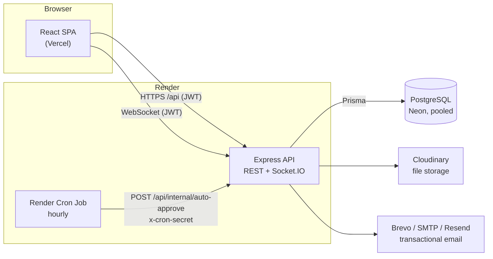
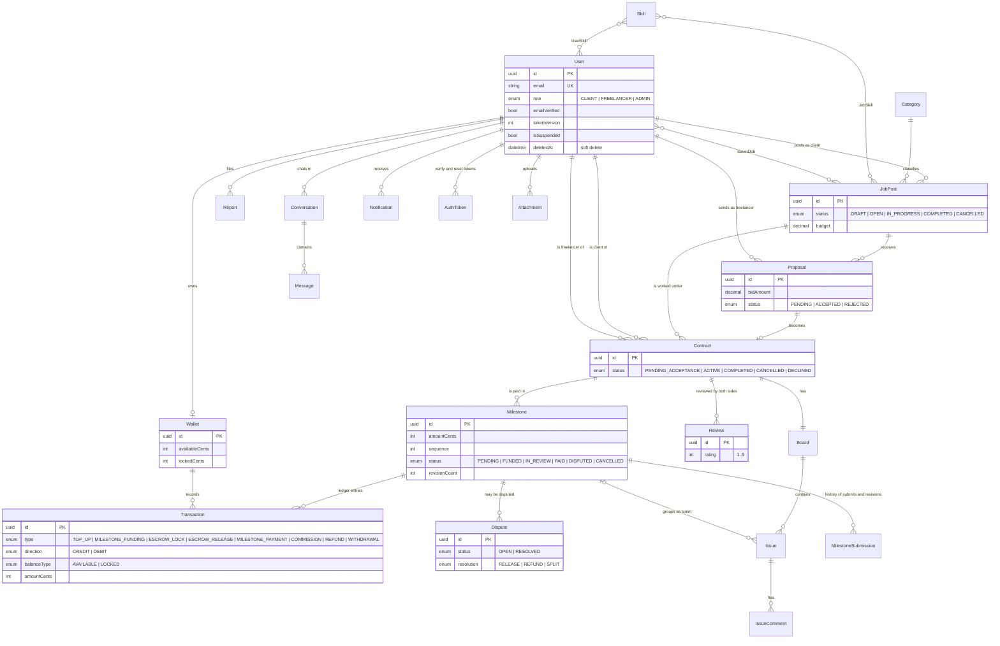
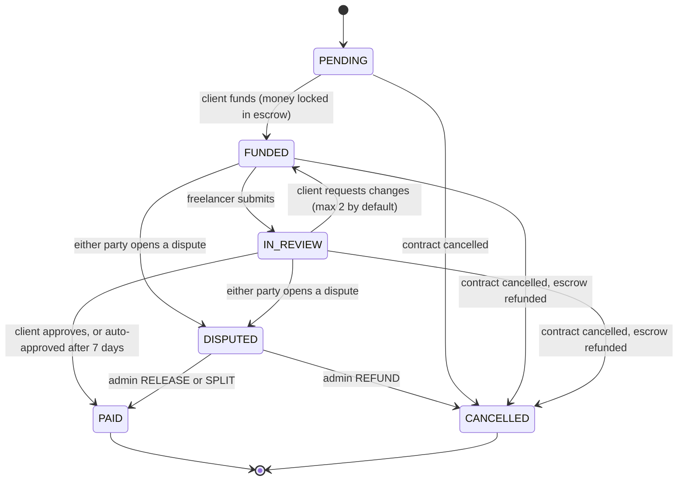

# Upra

**Hire. Collaborate. Deliver.**

Upra is a freelance marketplace where clients and freelancers agree on a contract, pay through **milestone escrow**, run the project on a built-in **Kanban workspace**, talk in **real-time chat**, and rely on an **admin** to settle disputes. It is a full-stack portfolio project (React + Express + PostgreSQL) built around one question: how do you make money movement between two strangers safe, auditable and race-free?

> **Demo project.** There is no payment provider. Every balance, escrow lock and payout is simulated test money, and the UI says so on every screen.

<!-- TODO: add live URLs here after the first deploy: Frontend (Vercel) · API health (Render) · Demo video -->

---

## Contents

1. [Features](#features)
2. [Tech stack](#tech-stack)
3. [Architecture](#architecture)
4. [Data model](#data-model)
5. [Milestone and contract lifecycle](#milestone-and-contract-lifecycle)
6. [Screenshots](#screenshots)
7. [Getting started](#getting-started)
8. [Demo accounts](#demo-accounts)
9. [Testing and CI](#testing-and-ci)
10. [Deployment](#deployment)
11. [API overview](#api-overview)
12. [Architecture decisions](#architecture-decisions)
13. [Security](#security)
14. [Project structure](#project-structure)
15. [Limitations and roadmap](#limitations-and-roadmap)

---

## Features

**Clients**
- Post jobs through a 3-step wizard (category, level, skills, budget, deadline); drafts stay private until published.
- Review proposals and send a **contract offer** split into milestones (the dialog checks that the milestones add up to the bid).
- Fund milestones one by one, approve work, request changes (limited revisions) or open a dispute.
- Wallet with demo top-up, escrow cards and a full transaction history.

**Freelancers**
- Find Work with search, category/skill/level filters, saved jobs and a match score.
- Send, edit and withdraw proposals; accept or decline a contract offer.
- Work on a Kanban board that unlocks once the client has put money in escrow; submit milestones with file attachments.
- Receive payouts (10% platform fee) and withdraw demo funds.

**Everyone**
- Email verification and password reset (Brevo, SMTP or Resend).
- Real-time notifications and one permanent chat per client-freelancer pair (Socket.IO).
- Two-sided reviews after a contract completes, with an average rating on each profile.
- Profile with skills, availability, avatar and a visibility switch; account deletion (soft delete).
- Responsive layout (tested at a phone viewport).

**Admins**
- Resolve disputes: release to the freelancer, refund the client, or split.
- Review user reports and suspend or restore accounts.

---

## Tech stack

| Layer | Technology |
| --- | --- |
| Frontend | React 19, Vite, React Router 7, Redux Toolkit + RTK Query, React Hook Form + Zod, Tailwind CSS 4, `@hello-pangea/dnd`, Socket.IO client |
| Backend | Node.js (ESM), Express 5, Prisma 6, Zod, Socket.IO, Helmet, express-rate-limit, Winston |
| Database | PostgreSQL 16 (Neon in production) |
| Files | Cloudinary (production), local disk (development and tests only) |
| Email | Brevo API, SMTP (nodemailer) or Resend; links are printed to the log in development |
| Tests | Jest + Supertest (backend), `node --test` (frontend units), Playwright (E2E, desktop and mobile) |
| CI/CD | GitHub Actions; deploy on Vercel (frontend), Render (API + cron), Neon (database) |

---

## Architecture



The backend is layered as `routes -> validators (Zod) -> controllers -> services -> Prisma`. **All money movement lives in one module**, `src/services/financialService.js`; controllers never touch wallets or the ledger directly.

---

## Data model

Core entities and their relations (field lists are abbreviated; see `backend/prisma/schema.prisma` for the full schema).



Notes:
- Money is stored as **integer USD cents** everywhere; there is no floating point in the money path.
- `Transaction` is an **append-only ledger**. Every operation writes all of its rows with the same `reference`.
- `Attachment` can point to a user (avatar), contract, milestone, submission, dispute, issue, comment or report.
- `Report.targetId` is polymorphic (paired with `targetType`), so it has no foreign key.

---

## Milestone and contract lifecycle



Contract: `PENDING_ACCEPTANCE -> ACTIVE` (freelancer accepts) or `DECLINED`; `ACTIVE -> COMPLETED` automatically when every milestone is `PAID` or `CANCELLED`, at least one is `PAID` and no dispute is open; `ACTIVE -> CANCELLED` directly before work starts, or by mutual agreement afterwards.

**Money example** (a $500 milestone, 10% platform fee, rounded down to whole cents):

| Step | Client wallet | Freelancer wallet | Ledger rows |
| --- | --- | --- | --- |
| Fund | available -$500, locked +$500 | | `MILESTONE_FUNDING` DEBIT available, `ESCROW_LOCK` CREDIT locked |
| Approve | locked -$500 | available +$450 | `ESCROW_RELEASE` DEBIT locked $500; `MILESTONE_PAYMENT` CREDIT $500 and `COMMISSION` DEBIT $50 on the freelancer wallet |
| Dispute REFUND | locked -$500, available +$500 | | `ESCROW_RELEASE`, `REFUND` (no commission) |
| Dispute SPLIT $300 / $200 | locked -$500, available +$200 | available +$270 | commission is charged only on the released $300 |

---

## Screenshots

| | |
| --- | --- |
|  **Find Work** with filters and match score |  **Post a job** wizard |
|  **Contract offer** split into milestones |  **Project workspace** (Kanban board) |
|  **Escrow tab**: fund, submit, approve |  **Admin** resolving a dispute |
|  **Dashboard** with wallet and escrow cards |  **Mobile** layout |

---

## Getting started

### Prerequisites

- Node.js 26+ (see `engines` in `backend/package.json`; CI uses 26)
- PostgreSQL 13+ (CI uses 16)
- npm

### 1. Backend

```bash
cd backend
npm install
cp .env.example .env        # PowerShell: Copy-Item .env.example .env
```

Edit `backend/.env` and set at least `DATABASE_URL` and `JWT_SECRET`. Leave the email variables empty in development: verification and reset links are printed to the server log.

```bash
npm run db:sync             # prisma migrate deploy + prisma generate (categories and skills ship with the migrations)
npm run seed                # optional: demo accounts and data, see "Demo accounts"
npm run dev                 # http://localhost:5000, health check at /api/health
```

Promote an existing account to admin (there is no public admin sign-up):

```bash
npm run admin:promote -- user@example.com
```

### 2. Frontend

```bash
cd frontend
npm install
npm run dev                 # http://localhost:5173
```

The frontend talks to `http://localhost:5000/api` by default. To point it elsewhere, set `VITE_API_URL` (it must end in `/api`; the Socket.IO URL is derived from it).

### Environment variables

`backend/.env.example` documents every variable. The important ones:

| Variable | Purpose |
| --- | --- |
| `DATABASE_URL` | PostgreSQL connection string (Neon: pooled URL for the API, direct URL for migrations) |
| `JWT_SECRET` | Required; the server refuses to start without it |
| `CLIENT_URL` | Allowed frontend origin(s) for CORS and Socket.IO |
| `UPLOAD_PROVIDER`, `CLOUDINARY_*` | `cloudinary` in production; local storage is rejected there |
| `BREVO_API_KEY` / `SMTP_*` / `RESEND_API_KEY`, `EMAIL_FROM`, `APP_URL` | Email delivery (priority Brevo, then SMTP, then Resend) |
| `REQUIRE_EMAIL_VERIFICATION` | Blocks unverified accounts from posting jobs and sending proposals (default: on in production) |
| `CRON_SECRET`, `ENABLE_SCHEDULER` | Protect the external auto-approve endpoint; toggle the in-process scheduler |
| `DEMO_TOPUP_ENABLED` | `false` disables the demo wallet top-up endpoint |

---

## Demo accounts

`npm run seed` (in `backend/`) creates a ready-made story. Password for every account: **`Demo12345!`**

| Account | Role | What you will find |
| --- | --- | --- |
| `admin@demo.upra.local` | Admin | One open dispute and one open report to review |
| `leyla.client@demo.upra.local` | Client | A completed contract with reviews (Aysel), an open dispute (Nigar), two open jobs, one draft |
| `orxan.client@demo.upra.local` | Client | A milestone waiting for approval (Rauf), a contract offer waiting for Tural, an unread message |
| `aysel.freelancer@demo.upra.local` | Freelancer | Completed contract, 5-star review, balance to withdraw, one pending proposal |
| `rauf.freelancer@demo.upra.local` | Freelancer | Active contract with a milestone in review |
| `nigar.freelancer@demo.upra.local` | Freelancer | Active contract in dispute |
| `tural.freelancer@demo.upra.local` | Freelancer | A contract offer to accept |

Seed commands and safety rules:

```bash
npm run seed                        # delete and recreate the demo data (safe to repeat)
npm run seed:reset                  # delete the demo data only
npm run seed -- --allow-remote      # explicit opt-in for a non-local (demo) database
```

- Refuses to run with `NODE_ENV=production`.
- Refuses a non-local database host unless `--allow-remote` is passed.
- Touches only accounts ending in `@demo.upra.local` and the data attached to them.
- Money is created through the real service functions (`topUp`, `fundMilestone`, `approveMilestone`, `openDispute`, ...), so the ledger is always consistent.

A step-by-step recording plan that uses these accounts is in [`docs/DEMO_SCRIPT.md`](docs/DEMO_SCRIPT.md).

---

## Testing and CI

| Suite | Command | Notes |
| --- | --- | --- |
| Backend (Jest + Supertest, 32 test files) | `cd backend && npm test` | Needs `backend/.env.test`; the database name **must end in `_test`**. Pending migrations stop the run; apply them with `UPRA_TEST_DB_MIGRATE=1 npm test` (PowerShell: `$env:UPRA_TEST_DB_MIGRATE="1"; npm test`). |
| Frontend lint | `cd frontend && npm run lint` | |
| Frontend units | `cd frontend && npm test` | Node's built-in test runner |
| E2E (Playwright) | `cd frontend && npm run e2e` | Needs `E2E_DATABASE_URL` pointing to a database whose name **ends in `_e2e`**. Starts its own backend (port 5100) and frontend (port 5174). First run: `npm run e2e:install`. |

Backend tests cover the escrow ledger and commission, milestone races, disputes, revisions, reports and admin moderation, reviews, attachments, email verification and password reset, rate limiting, upload configuration, health check and automatic contract completion.

The E2E suite has three specs:
- `main-flow`: register, post a job, send a proposal, make a contract offer with two milestones, accept it, fund, submit and approve both milestones, check the 10% fee, see the contract complete automatically, then exchange reviews.
- `auth`: guards, login and logout, role protection, demo labels.
- `mobile` (Pixel 5 viewport): no horizontal scroll, hamburger navigation, posting a job and sending a proposal from a phone.

GitHub Actions (`.github/workflows/ci.yml`) runs three jobs on every pull request and push to `main`: backend tests against a Postgres 16 service, frontend lint + unit tests + build, and the Playwright suite (desktop and mobile) with the report uploaded as an artifact.

The test runners refuse to start against a database that does not look like a throwaway one, so a wrong `.env` cannot wipe development data.

---

## Deployment

Target setup: **Neon** (PostgreSQL) + **Render** (API and cron job) + **Vercel** (frontend) + **Cloudinary** (files) + **Brevo** (email).

1. **Database.** Create a Neon project. Use the *pooled* connection string for the API and the *direct* one for migrations: `DATABASE_URL="<direct url>" npx prisma migrate deploy`.
2. **API on Render.** Web service with root directory `backend`, build `npm install && npx prisma generate`, start `npm start`, health check path `/api/health`. Set the environment variables listed in [`backend/DEPLOYMENT.md`](backend/DEPLOYMENT.md). With `NODE_ENV=production` the server exits at startup if Cloudinary or email delivery is not configured.
3. **Cron.** Render Cron Job, hourly, calling `POST /api/internal/auto-approve` with the `x-cron-secret` header. This also wakes a sleeping free instance.
4. **Frontend on Vercel.** Root directory `frontend`, framework preset Vite, environment variable `VITE_API_URL=https://<your-api>.onrender.com/api`. `vercel.json` rewrites every path to `index.html` so deep links work. Then set `CLIENT_URL` and `APP_URL` on Render to the Vercel origin.
5. **Demo data (optional).** Use a *separate* demo database (for example a Neon branch), never production: `npm run seed -- --allow-remote` with that database in `DATABASE_URL`.

Post-deploy checklist: `GET /api/health` returns `{"status":"ok"}`; register an account and receive the verification email; upload a file in a milestone submission and download it through the app; call the cron endpoint with a wrong secret (expect 401) and the right one (expect 200 with a summary); open the site on a phone.

---

## API overview

All routes are under `/api` and use a Bearer JWT unless marked public.

| Area | Routes |
| --- | --- |
| Health | `GET /health` (public) |
| Auth | `POST /auth/register`, `/auth/login`, `/auth/verify-email`, `/auth/verify-email/send`, `/auth/forgot-password`, `/auth/reset-password`; `GET /auth/me`; `PATCH /auth/update-me`, `/auth/update-password`; `DELETE /auth/me` |
| Taxonomy | `GET /categories`, `/skills` (public) |
| Jobs | `GET /jobs` (public, richer when signed in), `/jobs/my`, `/jobs/saved`, `/jobs/:id`; `POST /jobs`, `/jobs/:id/publish`, `/jobs/:id/save`; `PATCH`/`DELETE /jobs/:id` |
| Proposals | `POST /proposals`; `GET /proposals/my`, `/proposals/job/:jobId`, `/proposals/:id`; `PATCH`/`DELETE /proposals/:id` |
| Contracts | `POST /contracts`; `GET /contracts/my`, `/contracts/:id`, `/:id/milestones`, `/:id/history`, `/:id/reviews`; `PATCH /:id/accept`, `/decline`, `/complete`, `/cancel`, `/cancel-request[/accept\|/decline\|/withdraw]`; `POST /:id/reviews` |
| Milestones | `POST /milestones/:id/fund`, `/submit`, `/approve`, `/request-changes`, `/dispute` |
| Wallet | `GET /wallet`; `POST /wallet/topup`, `/wallet/withdraw` |
| Workspace | `GET`/`POST /contracts/:contractId/issues`; `PATCH /issues/:id`, `/issues/:id/move`; `DELETE /issues/:id`; `POST /issues/:id/comments` |
| Chat | `GET /conversations`, `/conversations/unread-count`, `/:id`, `/:id/messages`; `POST /conversations`, `/:id/messages`; `PATCH /:id/read` |
| Notifications | `GET /notifications`, `/unread-count`; `PATCH /read-all`, `/:id/read` |
| Attachments | `POST /attachments/avatar`, `/milestones/:id/files`, `/disputes/:id/files`, `/issues/:id/files`, `/issue-comments/:id/files`, `/reports/:id/files`; `GET /attachments/:id`, `/:id/content` |
| Reports | `POST /reports` |
| Users | `GET /users/:id`, `/dashboard/stats` |
| Admin | `GET /admin/disputes[/:id]`, `PATCH /admin/disputes/:id/resolve`; `GET /admin/reports[/:id]`, `PATCH /admin/reports/:id`; `GET /admin/users`, `PATCH /admin/users/:id/suspension` |
| Internal | `POST /internal/auto-approve` (shared secret header, not a user route) |

Real-time events (Socket.IO, JWT in the handshake): `notification:new`, `message:new`, `milestone:updated`, `contract:updated`, `dispute:updated`. Each user joins a private `user:<id>` room; contract rooms (`join_contract`) check that the user is a party to the contract.

---

## Architecture decisions

| Decision | Why |
| --- | --- |
| **Money as integer cents, append-only ledger, CHECK constraints.** | Floats cannot represent money safely. A ledger that is only ever appended to can be audited and reconciled: for every wallet, credits minus debits equal the balance change. |
| **One service owns all money movement; one contract-row lock per operation.** Every operation runs in a single transaction that first locks the `Contract` row (`SELECT ... FOR UPDATE`), then flips the milestone with a conditional `updateMany` (`where status = expected`), then updates wallets in ascending `userId` order. | Operations on the same contract are queued, so there are no double approvals or double fundings. The conditional update makes retries safe without a separate idempotency table. A fixed wallet lock order prevents deadlocks between contracts with reversed roles. Only Prisma `P2034` conflicts are retried, at most three times. |
| **Escrow before work.** The Kanban board stays locked until at least one milestone is funded. | The freelancer knows the money exists before starting; the client's money is committed, not promised. |
| **A milestone is also the sprint.** Issues attach to a milestone; there is no separate sprint model. | One concept for both "what is being built" and "what is being paid for", which keeps the UI and the rules simple. |
| **Platform fee of 10% on the freelancer's payout, floored to whole cents.** No platform wallet. | Easy to explain and verify. The fee is charged only on money actually released (so a refund carries no fee and a split is charged on the released part). |
| **Automatic approval after 7 days in review, driven by an external cron endpoint.** The endpoint compares the secret in constant time, returns 404 when `CRON_SECRET` is unset and 401 on a wrong secret. An optional in-process scheduler can be switched off. | A silent client must not hold a freelancer's pay hostage. Free Render instances sleep, so in-process timers alone are unreliable; the cron request wakes the instance. The rule itself lives in `approveMilestone`, so the cron job only decides *when to try*. |
| **Automatic contract completion.** After the last payment or dispute resolution the contract completes itself when all milestones are terminal, at least one is paid and no dispute is open. | Removes a manual step that people forget, and keeps reviews and job status consistent. Cancelling is blocked while a dispute is open so escrow can never be released twice. |
| **Disputes are decided by an admin; money stays frozen meanwhile.** At most one open dispute per milestone (also enforced by a partial unique index). Outcomes: release, refund or split. | Gives both sides a way out of a deadlock without letting either one move the money. |
| **One permanent chat per client-freelancer pair.** It survives finished contracts and is reused for new ones. | Conversations follow relationships, not contracts; no empty rooms per contract. |
| **JWT with a `tokenVersion`; one-time email tokens stored only as SHA-256 hashes with an expiry.** Resetting the password bumps the version, which invalidates old sessions and sockets. | A stolen database dump does not reveal usable tokens, and a password reset really signs everyone out. |
| **Login limiter counts failures only, per IP; a successful login clears that account's failures.** No per-account lockout. In-memory store. | Blocking an account would let anyone lock out anyone else by typing their email. Counting only failures stops the limiter from blocking honest users behind a shared IP. A shared store (Redis) is needed if the API runs on several instances. |
| **Files: Cloudinary in production only; downloads go through an authenticated endpoint.** The server refuses to start in production with local storage. Metadata responses hide storage URLs. | The Render disk is ephemeral, so silent local fallback would lose files. Access checks (contract party, uploader, reporter or admin) happen on every download. |
| **Soft delete and suspension instead of hard delete.** | Ledger rows, contracts and chat history must stay readable and consistent after an account is gone. |
| **Reviews are immutable, one per side per contract, allowed only on completed contracts; ratings are computed with an aggregate query.** | No edit or delete means no review tampering; no stored counters means no drift. |
| **Destructive tooling is guarded.** The backend test runner demands a `*_test` database, the E2E config a `*_e2e` database, and the seed refuses production and remote databases without a flag. | A wrong `.env` should be an error message, not a data-loss incident. |
| **Demo money is labelled everywhere.** A badge in the app bar, a notice on sign-up and the escrow tab, and a note in every money confirmation dialog. | The project looks and behaves like a real payment flow; nobody should mistake it for one. |

---

## Security

- Passwords hashed with bcrypt; JWT sessions with a revocation counter; suspended and deleted users are rejected on every request and on socket connect.
- Request validation with Zod on every write endpoint; Helmet; CORS restricted to `CLIENT_URL`.
- Rate limits for login (failures), registration, token endpoints (per IP and per email), verification mail, wallet top-up and chat messages.
- Role checks on routes plus party checks in services (a client cannot approve someone else's milestone).
- Admin role can only be granted by the `admin:promote` script; registration cannot create admins.
- Upload allow-lists per purpose (type and size), authenticated downloads, no public static upload mount in production.
- The internal cron endpoint is disabled unless `CRON_SECRET` is set.

---

## Project structure

```
upra/
├── backend/
│   ├── prisma/             # schema.prisma and SQL migrations (taxonomy seed data ships in a migration)
│   ├── scripts/            # run-tests.js, seed.js, promote-admin.js
│   ├── src/
│   │   ├── routes/         # HTTP routing
│   │   ├── validators/     # Zod schemas
│   │   ├── controllers/    # request handlers
│   │   ├── services/       # financial, notification, email, upload, auth tokens, reviews
│   │   ├── middlewares/    # auth, rate limits, upload, validation, errors
│   │   ├── socket.js       # Socket.IO setup and emit helpers
│   │   └── app.js, server.js
│   ├── tests/              # Jest suites and helpers
│   └── DEPLOYMENT.md
├── frontend/
│   ├── e2e/                # Playwright specs
│   └── src/
│       ├── features/       # RTK Query APIs and feature components (escrow, issues, wallet, chat, ...)
│       ├── pages/          # route-level pages (including admin/)
│       ├── components/     # layout and UI primitives
│       └── lib/, app/      # base API, formatting, labels, store
├── docs/
│   ├── DEMO_SCRIPT.md
│   ├── PRESENTATION_OUTLINE.md
│   └── screenshots/
└── .github/workflows/ci.yml
```

---

## Limitations and roadmap

**Known limitations**
- No real payment provider: all money is simulated.
- The failed-login limiter keeps its state in memory (one API instance). Use a shared store before scaling out.
- Cloudinary assets keep their delivery URL, so anyone holding a raw URL could fetch the file directly; the app never exposes those URLs, and they should be treated as private.
- A free Render instance sleeps when idle; the first request after a pause is slow.

**Optional next steps**
- AI-assisted suggestion for dispute resolution (`Dispute.aiSuggestion`; the admin still decides).
- Notifications for overdue milestones.
- Error monitoring with Sentry.
